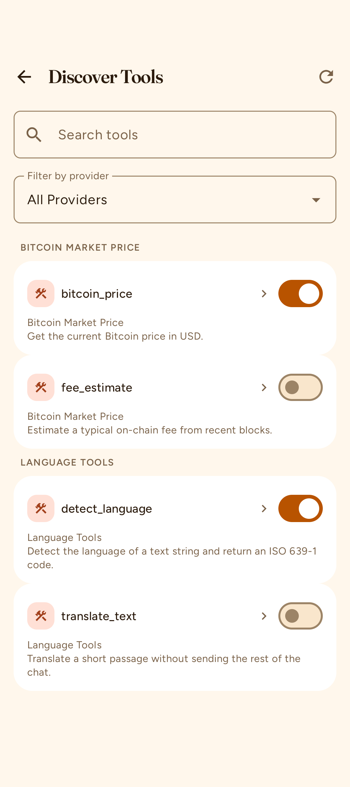
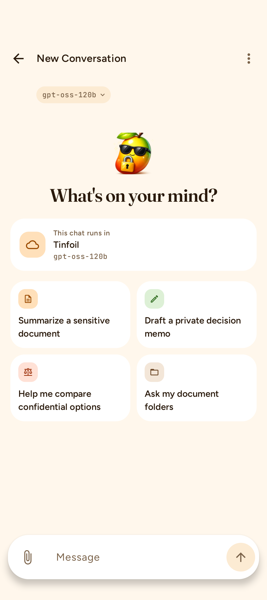
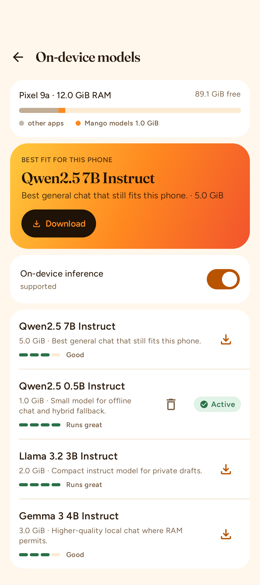
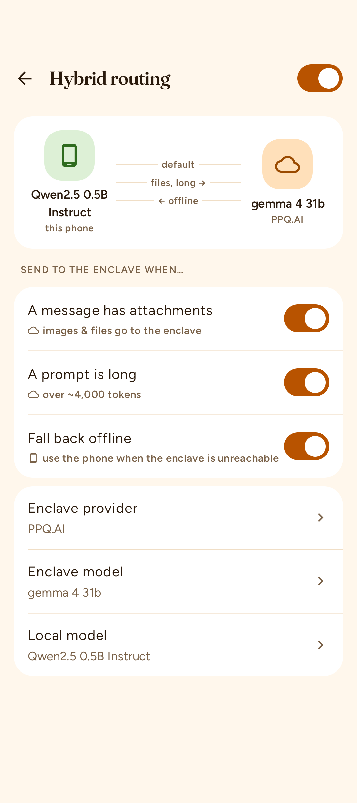

# Mango

Mango is a confidential AI client for chatting with confidential inference providers from a local app. It focuses on security, privacy, and local-first capabilities. Its based on BYOK (Bring Your Own Key), no subscriptions or cloud storage.

Available on Android (Jetpack Compose), iOS (SwiftUI), and desktop Linux/macOS (iced). All business logic lives in a shared Rust core; the native apps are thin UI layers.

## Integrated providers

Mango currently includes built-in support for:

- **Tinfoil** — AMD SEV-SNP attested inference (key required)
- **PPQ.AI** — private E2EE models running in AMD SEV-SNP TEEs
- **Venice.ai** — E2EE confidential inference
- **Redpill** — Intel TDX aggregator (Phala / NearAI / Chutes) with multi-quote attestation
- **Local server** — any OpenAI-compatible local endpoint such as Ollama or llama.cpp
- **Custom providers** — any OpenAI-compatible confidential or self-hosted endpoint

Provider model lists are refreshed live from each provider's `/v1/models` endpoint on app start, so the model picker always shows what providers actually serve today. Only providers you have configured (or local backends) appear in the picker; one model from your active provider is pre-selected for new chats.

It also integrates:

- Brave Search for web search tools

### PPQ managed accounts

Mango can set up a PPQ account automatically inside the app, so you do not need a PPQ account first. You fund it from any external Lightning wallet by scanning a QR code. Your PPQ balance is prepaid USD credit held by PPQ; Mango never touches the funds. Your credentials are stored on the device and can be exported to an encrypted `.mppq` backup with a password. A duress wipe erases local data while preserving PPQ credentials, and existing BYOK PPQ keys and custom providers still work. Back up, restore, or top up from **Settings → Providers**.

- Automatic PPQ setup
- Lightning top-up via external wallet or QR
- Encrypted `.mppq` backup and restore
- Duress wipe preserves PPQ credentials
- BYOK and custom providers still supported

## Appearance

On Android, choose **Settings → Appearance → Follow System**, **Force Light** (Ripe), or **Force Dark** (Enclave). The selection applies to the whole screen, including the background, text, cards, and system-bar icons.

Layouts accommodate larger system text with wrapping labels and scrollable forms. Onboarding and PIN forms also stay clear of system bars and the on-screen keyboard.

## Screenshots 

## Features

### Chat
- Streaming responses with markdown rendering, stop-generation, conversation rename, fork, and automatic titles
- One active response per chat engine: stop cancels streaming and tool work; late results cannot enter a later turn
- Model picker showing models available from your configured providers, with the active provider pre-selected
- Per-conversation system instructions and tool-use controls
- Image attachments for vision-capable models, stored encrypted at rest
- Context windows are respected at the model's real limit (learned from the provider, or the on-device engine's budget): long chats can be compacted — older turns are summarized for the model while the full history stays on the device
- Editing or deleting summarized turns clears the summary; deferred sends and compaction retries never follow you into another conversation

### Confidentiality & attestation
- Remote attestation verification for AMD SEV-SNP and Intel TDX/SGX quotes, fully on-device
- Per-provider attestation status (verified / expired / failed) in settings and the chat header
- Per-reply route metadata records which provider, model, and TEE served each answer, and whether that turn's attestation was verified
- Configurable re-attestation interval; TLS certificate binding to attested keys for supported transports
- Custom OpenAI-compatible TEE providers require a fresh attestation-bound TLS pin for inference, including tools, summaries, and memory extraction

PIN unlock permits one verification attempt at a time and persists an exponential cooldown after five failures. Locking or wiping invalidates pending authentication and attestation results. Genuine attestation failures remove cached trust, and cache entries dated in the future are not accepted. Data deletion reports failure rather than claiming erasure when required file or credential deletion cannot be verified.

### Hybrid local/remote routing
- Hybrid profiles pair an on-device model with a remote confidential provider: simple turns are answered locally, sensitive turns escalate to the attested remote TEE
- "Remote next" override to force the next turn to the confidential backend
- Per-turn routing summary (local vs. escalated, routing reason)

### Local models
- Downloadable on-device models (GGUF) with progress and disk management
- Use local models standalone, or as the local leg of a hybrid profile

### RAG & documents
- Local document library with PDF/text ingestion
- Attach documents to conversations for grounded answers; only that conversation's attached document chunks enter its RAG prompt
- Directory sources: watch a folder and auto-sync new documents into your library
- On-device embeddings and an encrypted local vector index — nothing leaves the device

### Local models
- Downloadable on-device GGUF models (Qwen and friends) via llama.cpp, with download progress, verification, and deletion from Settings → Browse local models
- Use local models standalone in the chat picker, or as the local leg of a hybrid profile
- Any local OpenAI-compatible server (Ollama, llama.cpp) works as a provider too

### Tools 
- Discovers remote [MCP tools over Nostr](https://contextvm.org) from curated public relays — pull-on-open, no background subscriptions
- Trust model: tools run only from providers you explicitly mark as trusted; a global auto-discover toggle and a per-conversation tools switch control exposure
- Turning off conversation tools disables built-in local tools even with remote auto-discovery enabled; discoveries never inherit approval from a different provider with the same tool name
- Invocations are signed JSON-RPC `tools/call` requests over Nostr using a persistent device key, with response size caps
- Discovered tools become callable by the agent (and by models with tool use) alongside built-in Brave web search

### Memory
- Automatic memory extraction from conversations
- Memory management view to review and remove memories

## Security & Privacy
- App lock with PIN and biometric unlock, configurable lock timeout
- Duress PIN support to erase local data
- Encrypted local persistence: SQLCipher database, encrypted vector index and image files
- Key storage in the platform keychain; keys never leave the device
- No telemetry, no cloud sync, no accounts required (BYOK)
- Onboarding flow for provider setup and attestation demo

